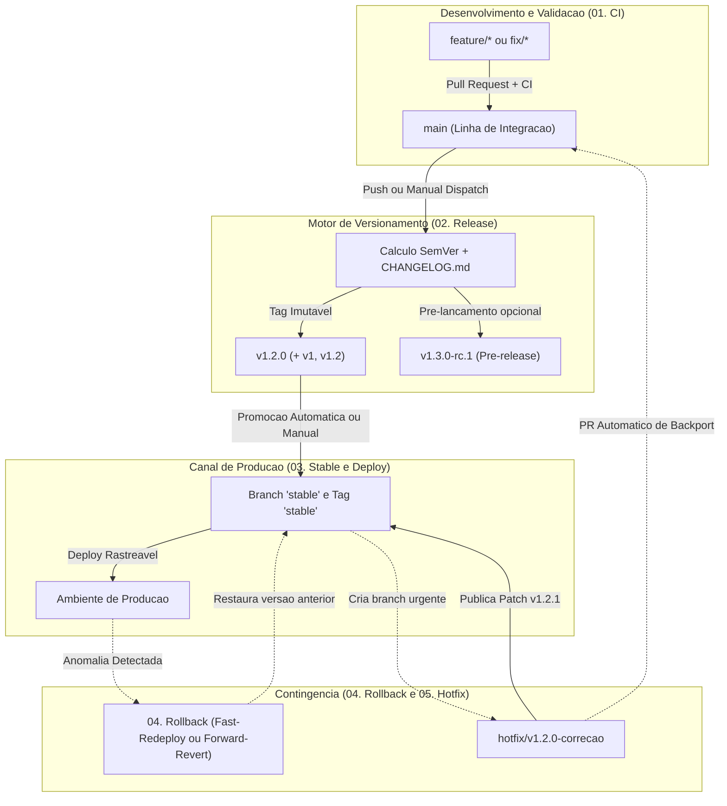

# Guia Padronizado de Workflows Git, SemVer, Releases, Stable e Rollbacks

Este repositorio contem uma estrutura modular e padronizada de engenharia de releases e CI/CD utilizando **Git + GitHub Actions**, projetada para ser reutilizada em projetos futuros.

---

## 1. Arquitetura de Branches, Tags e Canais

O modelo combina a integracao continua na branch principal (`main`) com o isolamento de producao atraves do canal **`stable`** e suporte a correcoes urgentes via **`hotfix/*`**:



### Papel de cada Referencia:
| Referencia | Tipo | Finalidade |
| :--- | :--- | :--- |
| `feature/*`, `fix/*` | Branch temporaria | Desenvolvimento de funcionalidades ou correcoes; validada pelo workflow **01. CI**. |
| `develop` *(opcional)* | Branch de integracao | Ambiente intermediario opcional antes da abertura de Pull Request para `main`. |
| `main` | Branch principal | Codigo consolidado pronto para compor a proxima release. |
| **`stable`** | **Branch e Tag movel** | **Referencia exata do codigo em Producao.** Atualizada exclusivamente pelos workflows de Deploy, Rollback e Hotfix. |
| `hotfix/*` | Branch de contingencia | Criada a partir de `stable` para corrigir falhas criticas em producao sem incluir alteracoes em andamento na `main`. |
| `vX.Y.Z` (ex: `v1.2.0`) | Tag SemVer imutavel | Registro permanente de cada versao lancada e publicada no **GitHub Releases**. |
| `vX`, `vX.Y` (ex: `v1`, `v1.2`) | Tags flutuantes | Apontam para a versao estavel mais recente dentro da respectiva serie Major/Minor. |

---

## 2. Estrutura Modular de Scripts (`scripts/`)

Os comandos de automacao foram separados por responsabilidade na pasta [`scripts/`](file:///d:/GitHub/test-github-actions/scripts), utilizando apenas modulos nativos do Node.js (sem necessidade de instalar pacotes externos):

### Modulos Base (`scripts/lib/`):
- [`scripts/lib/git.js`](file:///d:/GitHub/test-github-actions/scripts/lib/git.js): Execucao de comandos Git, leitura de URL do repositorio e parsing de argumentos de linha de comando.
- [`scripts/lib/semver.js`](file:///d:/GitHub/test-github-actions/scripts/lib/semver.js): Parser e comparador SemVer 2.0.0, listagem ordenada de tags (`stable` e `prerelease`) e calculo de incremento (`major`, `minor`, `patch`, `alpha`, `beta`, `rc`).
- [`scripts/lib/commits.js`](file:///d:/GitHub/test-github-actions/scripts/lib/commits.js): Analise e classificacao de commits segundo o padrao Conventional Commits.
- [`scripts/lib/changelog.js`](file:///d:/GitHub/test-github-actions/scripts/lib/changelog.js): Formatacao de notas de lancamento e atualizacao de [`CHANGELOG.md`](file:///d:/GitHub/test-github-actions/CHANGELOG.md), [`package.json`](file:///d:/GitHub/test-github-actions/package.json) e arquivo `VERSION`.

### Comandos Executaveis (`scripts/`):
- [`scripts/status.js`](file:///d:/GitHub/test-github-actions/scripts/status.js): Diagnostico do estado atual das versoes, tags e previa do proximo Changelog (`--preview`).
- [`scripts/validate-commits.js`](file:///d:/GitHub/test-github-actions/scripts/validate-commits.js): Validacao de mensagens de commit (utilizado no CI e localmente).
- [`scripts/prepare-release.js`](file:///d:/GitHub/test-github-actions/scripts/prepare-release.js): Calculo de nova versao, atualizacao de arquivos e geracao de metadados para o GitHub Actions.
- [`scripts/resolve-rollback.js`](file:///d:/GitHub/test-github-actions/scripts/resolve-rollback.js): Identificacao e validacao da versao de destino em operacoes de rollback.
- [`scripts/commit-guide.js`](file:///d:/GitHub/test-github-actions/scripts/commit-guide.js): Referencia rapida no terminal sobre regras de Conventional Commits.

---

## 3. Versionamento Semantico (SemVer) e Conventional Commits

O formato de versao segue **`MAJOR.MINOR.PATCH`** (ex: `v2.4.1`) ou **`MAJOR.MINOR.PATCH-canal.N`** para pre-lancamentos (ex: `v2.5.0-rc.1`).

| Prefixo do Commit | Exemplo | Incremento SemVer | Aplicacao |
| :--- | :--- | :--- | :--- |
| **`feat!:`** ou rodape `BREAKING CHANGE:` | `feat(api)!: remove suporte a rota v1` | **MAJOR** (`1.2.3` -> `2.0.0`) | Mudancas incompativeis com a API/contrato anterior. |
| **`feat:`** | `feat(auth): adiciona autenticacao OAuth2` | **MINOR** (`1.2.3` -> `1.3.0`) | Nova funcionalidade retrocompativel. |
| **`fix:`**, **`perf:`**, **`revert:`** | `fix(cart): corrige calculo de impostos` | **PATCH** (`1.2.3` -> `1.2.4`) | Correcao de bug, otimizacao de performance ou reversao. |
| `docs:`, `chore:`, `refactor:`, `test:`, `ci:`, `style:`, `build:` | `docs: atualiza documentacao tecnica` | **NENHUM** *(nao dispara release isolada em modo `auto`)* | Manutencao interna, testes, formatacao ou documentacao. |

---

## 4. Catalogo dos Workflows (`.github/workflows/`)

### 4.1. [`01. CI` — `.github/workflows/ci.yml`](file:///d:/GitHub/test-github-actions/.github/workflows/ci.yml)
- **Gatilhos:** Pull Requests para `main`, `stable`, `develop`, `release/**`, `hotfix/**` e pushes em branches de desenvolvimento.
- **Execucao:**
  1. Valida o padrao Conventional Commits atraves de [`scripts/validate-commits.js`](file:///d:/GitHub/test-github-actions/scripts/validate-commits.js).
  2. Executa `npm ci`, `npm run lint`, `npm run test` e `npm run build`.
  3. Aplica controle de concorrencia (`concurrency`) para interromper execucoes obsoletas na mesma branch.

### 4.2. [`02. Release` — `.github/workflows/release.yml`](file:///d:/GitHub/test-github-actions/.github/workflows/release.yml)
- **Gatilhos:**
  - **Automatico:** Push na branch `main`.
  - **Manual (`workflow_dispatch`):** Permite selecionar o incremento (`auto`, `patch`, `minor`, `major`, `prerelease-rc`, `prerelease-beta`, `prerelease-alpha`), definir uma versao especifica (`custom_version`) ou rodar em modo de simulacao (`dry_run`).
- **Execucao:**
  1. Executa a suite de testes e build antes de gerar a versao.
  2. Calcula a versao via [`scripts/prepare-release.js`](file:///d:/GitHub/test-github-actions/scripts/prepare-release.js), atualiza o `package.json` e registra as alteracoes no [`CHANGELOG.md`](file:///d:/GitHub/test-github-actions/CHANGELOG.md).
  3. Cria a tag imutavel (`vX.Y.Z`) e atualiza as tags de serie (`vX` e `vX.Y`).
  4. Publica a **GitHub Release** e aciona o workflow **03. Stable e Deploy** para versoes estaveis.

### 4.3. [`03. Stable e Deploy` — `.github/workflows/stable-deploy.yml`](file:///d:/GitHub/test-github-actions/.github/workflows/stable-deploy.yml)
- **Gatilhos:** Acionado automaticamente apos Release, Rollback ou Hotfix (`workflow_call`) ou manualmente (`workflow_dispatch`).
- **Execucao:**
  1. Realiza checkout exato da tag solicitada (`vX.Y.Z` ou `latest`).
  2. Valida testes e build da versao selecionada.
  3. Executa o deploy no ambiente (`production` ou `staging`).
  4. Atualiza a **branch `stable`** e a **tag `stable`** para apontarem para o commit implantado em producao.

### 4.4. [`04. Rollback` — `.github/workflows/rollback.yml`](file:///d:/GitHub/test-github-actions/.github/workflows/rollback.yml)
- **Gatilho:** Manual (`workflow_dispatch`) para reversao de emergencia.
- **Parametros:**
  - `target_version`: Informe `previous` para selecionar automaticamente a tag estavel imediatamente anterior, ou especifique a versao desejada (ex: `v1.0.0`).
  - `strategy`:
    - **`fast-redeploy`:** Reaponta a branch e a tag `stable` para a versao anterior e refaz o deploy imediatamente, sem modificar o historico de commits da branch `main`.
    - **`forward-revert-release`:** Restaura o estado do codigo da versao alvo na branch `main` e publica uma nova versao `PATCH` (ex: `v1.2.1` com falha -> gera `v1.2.2` contendo o codigo estavel da `v1.2.0`).
  - `deprecate_broken_release`: Marca a release problematica como Pre-release (`[ROLLED BACK]`) e adiciona um aviso no topo das notas de lancamento com data, responsavel e motivo.

### 4.5. [`05. Hotfix` — `.github/workflows/hotfix.yml`](file:///d:/GitHub/test-github-actions/.github/workflows/hotfix.yml)
- **Gatilho:** Manual (`workflow_dispatch`).
- **Operacao:**
  1. **`create-hotfix-branch`:** Cria uma branch `hotfix/vX.Y.Z-identificador` diretamente a partir da tag `stable`.
  2. **`publish-hotfix`:** Apos o commit da correcao na branch de hotfix, gera uma nova versao `PATCH`, publica a Release, atualiza o canal `stable` e abre um **Pull Request de Backport** para a branch `main`.

---

## 5. Comandos Locais (NPM Scripts)

Os seguintes atalhos estao disponiveis no [`package.json`](file:///d:/GitHub/test-github-actions/package.json):

```bash
# Diagnostico da versao atual, tags e proximo incremento previsto
npm run version:status

# Previa do Changelog que sera gerado na proxima versao
npm run version:preview

# Validacao dos ultimos commits locais no padrao Conventional Commits
npm run commit:check

# Guia de referencia de Conventional Commits no terminal
npm run commit:guide

# Preparacao local de versoes (atualiza package.json e CHANGELOG.md)
npm run release:patch
npm run release:minor
npm run release:major
npm run release:rc
npm run release:beta
```

---

## 6. Reutilizacao em Projetos Futuros

1. Copie para o novo repositorio os diretorios [`.github/`](file:///d:/GitHub/test-github-actions/.github), [`scripts/`](file:///d:/GitHub/test-github-actions/scripts) e o arquivo [`CHANGELOG.md`](file:///d:/GitHub/test-github-actions/CHANGELOG.md).
2. No GitHub, acesse **Settings -> Actions -> General -> Workflow permissions** e habilite:
   - **Read and write permissions**
   - **Allow GitHub Actions to create and approve pull requests**
3. Para projetos que nao utilizam Node.js (ex: Python, Go, C#, Rust, Docker), basta manter um arquivo `VERSION` na raiz do repositorio (ex: `1.0.0`) e ajustar os comandos de teste, build e deploy nos arquivos `.github/workflows/*.yml`.
