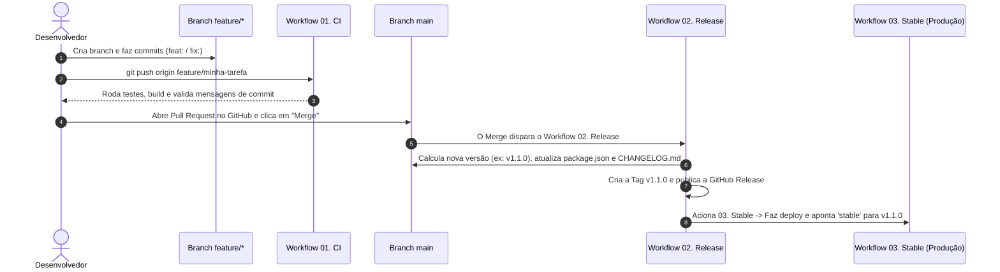

# Manual Completo: Arquitetura de Workflows Git, Versionamento Semântico, Releases, Stable, Rollback e Integração Real

Este documento explica em detalhes o funcionamento do fluxo de trabalho padronizado deste repositório, como operar entre as branches no dia a dia e como integrar esta estrutura em projetos reais de produção.

---

## 1. O Papel de Cada Branch e Tag (Quem mexe no quê?)

Para não haver confusão sobre onde programar e o que cada referência significa, o repositório é dividido em **3 camadas**:

| Referência (Branch / Tag) | Quem altera? | Finalidade prática |
| :--- | :--- | :--- |
| **`feature/*` ou `fix/*`** | **Desenvolvedor** | Bancada de trabalho diária. Toda nova funcionalidade ou correção começa em uma branch criada a partir da `main`. |
| **`main`** | **Desenvolvedor (via Pull Request)** | Linha principal de integração. **Toda vez que código novo entra na `main`, o robô gera uma nova versão.** |
| **`stable` (Branch e Tag)** | **Apenas o GitHub Actions** | Espelho fiel do ambiente de **Produção**. Você nunca faz commit manual nela; os workflows a atualizam automaticamente após cada deploy ou rollback. |
| **Tags `vX.Y.Z` (ex: `v1.1.1`)** | **Apenas o GitHub Actions** | Pontos de salvamento permanentes no histórico (checkpoints). Permitem voltar a qualquer versão exata no futuro. |
| **Tags `vX` e `vX.Y` (`v1`, `v1.1`)** | **Apenas o GitHub Actions** | Ponteiros móveis que sempre apontam para a última versão estável daquela família Major/Minor. |

### A dúvida clássica: `main`, `Latest` e `stable` são a mesma coisa?
- **Na rotina normal (99% do tempo): SIM.** Assim que você faz Merge de um Pull Request na `main`, o workflow `02. Release` cria a versão nova (ex: `v1.1.1`), marca essa versão como **`Latest`** nas Releases do GitHub e promove o código para a branch **`stable`**. Nesse momento, `main`, `Latest` e `stable` apontam exatamente para o mesmo código.
- **Quando elas ficam diferentes?** Apenas em 3 situações específicas:
  1. **Commits administrativos na `main` (`docs:`, `chore:`):** Eles entram na `main`, mas como não alteram o funcionamento do sistema, não geram versão nova. A `main` fica 1 commit à frente, enquanto `stable` e `Latest` continuam na última versão lançada.
  2. **Pré-lançamentos (`rc`, `beta`, `alpha`):** Se você lançar uma `v1.2.0-rc.1` para testes, ela fica registrada nas tags, mas a Produção (`stable`) e o selo `Latest` continuam apontando para a última versão estável (`v1.1.1`).
  3. **Rollback apenas de ponteiro (`only-stable-pointer`):** Quando você decide reverter apenas o servidor de Produção (`stable`) para a `v1.0.0` enquanto investiga o problema no código da `main` (`v1.1.0`).

---

## 2. O Fluxo do Dia a Dia Passo a Passo

Veja o caminho completo que uma alteração percorre desde o seu computador até a Produção:



### Passo 1: Iniciar uma tarefa nova
Sempre parta da `main` sincronizada e crie uma branch para a sua alteração:
```bash
git checkout main
npm run git:sync
git checkout -b feature/nova-funcionalidade
```
*(Nota: `npm run git:sync` executa `git fetch origin --tags --force && git pull origin main`, garantindo que tanto o código quanto as tags móveis do robô sejam atualizados sem conflito).*

### Passo 2: Programar e fazer Commits Semânticos
O prefixo da mensagem do `git commit` informa ao workflow `02. Release` como calcular a próxima versão quando o código chegar na `main`:

| Prefixo | Significado | Impacto na Versão (SemVer) | Exemplo |
| :--- | :--- | :--- | :--- |
| **`fix:`** / **`perf:`** / **`revert:`** | Correção de bug, melhoria de performance ou reversão | **PATCH** (`1.0.0` -> **`1.0.1`**) | `git commit -m "fix(login): corrige validacao de senha"` |
| **`feat:`** | Nova funcionalidade compatível com o que já existe | **MINOR** (`1.0.1` -> **`1.1.0`**) | `git commit -m "feat(relatorio): adiciona exportacao CSV"` |
| **`feat!:`** *(com `!`)* | Mudança incompatível (quebra integrações antigas) | **MAJOR** (`1.1.0` -> **`2.0.0`**) | `git commit -m "feat(api)!: altera formato do token"` |
| **`chore:`** / **`docs:`** / **`refactor:`** / **`test:`** / **`ci:`** | Manutenção interna, documentação, refatoração ou testes | **NENHUM** *(não gera release sozinha)* | `git commit -m "docs: atualiza guia de instalacao"` |

#### Dica prática: `git commit -m` vs `git commit -am`
- **`git commit -m "mensagem"`:** Salva no commit apenas os arquivos que você adicionou antes com `git add`. Obrigatório quando você **criou arquivos novos**.
- **`git commit -am "mensagem"`:** Faz `git add` automático e `commit` juntos para arquivos que **já existiam** no projeto e foram apenas editados.

### Passo 3: Enviar a branch (`git push`) e validação do `01. CI`
```bash
git push origin feature/nova-funcionalidade
```
- O código ainda **não** foi para a `main` e ainda **não** gerou versão.
- O workflow **[`01. CI`](file:///d:/GitHub/test-github-actions/.github/workflows/ci.yml)** roda automaticamente na sua branch para garantir que os testes (`npm run test`), o build (`npm run build`) e o formato dos commits estão corretos.

### Passo 4: Abrir o Pull Request e fazer o Merge na `main`
1. No GitHub, clique em **Compare & pull request** para abrir o PR da sua branch para a `main`.
2. O modelo [`.github/PULL_REQUEST_TEMPLATE.md`](file:///d:/GitHub/test-github-actions/.github/PULL_REQUEST_TEMPLATE.md) será exibido. Para marcar as caixas `[ ]`, basta colocar um `x` dentro (`[x]`) ou clicar diretamente nas caixinhas após criar o PR.
3. Com o check do **01. CI** aprovado, clique em **Merge pull request**.

### Passo 5: O que acontece sozinho após o Merge (`02. Release` + `03. Stable`)
Assim que o código entra na `main`:
1. O workflow **[`02. Release`](file:///d:/GitHub/test-github-actions/.github/workflows/release.yml)** calcula a nova versão, atualiza o [`package.json`](file:///d:/GitHub/test-github-actions/package.json) e o [`CHANGELOG.md`](file:///d:/GitHub/test-github-actions/CHANGELOG.md), faz um commit automático `chore(release): vX.Y.Z [skip ci]`, cria a tag e publica a **GitHub Release**.
2. Dentro da mesma execução do `02. Release`, ele chama como segunda etapa conectada o workflow **[`03. Stable e Deploy`](file:///d:/GitHub/test-github-actions/.github/workflows/stable-deploy.yml)**, que realiza o deploy em produção e atualiza a branch `stable` e a tag `stable`.

> **Por que o `03. Stable e Deploy` aparece dentro do `02. Release`?**
> Porque ele utiliza o recurso de *Reusable Workflows* (`workflow_call`) do GitHub Actions. Ao clicar na execução do `02. Release` (ou do `04. Rollback` / `05. Hotfix`), você verá o gráfico com as duas caixas conectadas por uma seta: a primeira preparando a versão e a segunda promovendo para `stable`.

---

## 3. Operações de Emergência e Casos Especiais

### 3.1. Rollback (`04. Rollback`) — Quando uma versão sobe com problema
Se a versão recém-lançada (ex: `v1.1.0`) apresentar falha em produção, vá na aba **Actions > `04. Rollback` > Run workflow**:

- **`target_version`:** Deixe `previous` (volta automaticamente para a versão estável imediatamente anterior) ou digite a tag desejada (ex: `v1.0.0`).
- **`strategy` (Escolha como deseja reverter):**
  1. **`revert-main-and-stable` (Padrão recomendado):** Volta tanto a Produção (`stable`) quanto os arquivos e o `package.json` da branch `main` para a versão anterior (`v1.0.0`).
  2. **`only-stable-pointer`:** Volta imediatamente o servidor de Produção (`stable`) para a `v1.0.0`, mas mantém a branch `main` na `v1.1.0` para você corrigir o erro com calma.
  3. **`forward-revert-release`:** Pega o código antigo da `v1.0.0`, restaura na `main` e lança como uma versão nova acima da atual (`v1.1.1`). Ideal quando você publica pacotes no NPM, Docker Hub ou lojas de apps que não aceitam voltar para números menores.
- **`delete_broken_tag`:**
  - Se `false` (padrão): Mantém a Release problemática no histórico com um alerta `[ROLLED BACK]` no título e na descrição para auditoria.
  - Se `true`: Exclui completamente a tag e a Release problemática do GitHub, permitindo que a numeração seja reutilizada no futuro.

### 3.2. Hotfix (`05. Hotfix`) — Correção urgente sem misturar com a `main`
Quando a branch `main` já possui commits de funcionalidades futuras que ainda não podem ir ao ar, mas você precisa consertar um bug urgente na versão que está em Produção (`stable`):

1. Vá em **Actions > `05. Hotfix` > Run workflow** e escolha **`create-hotfix-branch`** (informando um nome curto como `corrige-pagamento`).
2. O robô criará uma branch `hotfix/v1.0.0-corrige-pagamento` partindo exatamente da tag `stable` atual.
3. No seu computador, baixe a branch, aplique a correção e envie:
   ```bash
   git fetch origin
   git checkout hotfix/v1.0.0-corrige-pagamento
   git commit -am "fix: corrige calculo de pagamento"
   git push origin hotfix/v1.0.0-corrige-pagamento
   ```
4. Volte em **Actions > `05. Hotfix` > Run workflow**, escolha **`publish-hotfix`** e informe o nome da branch `hotfix/v1.0.0-corrige-pagamento`.
5. O robô lançará a versão `v1.0.1` direto em Produção (`stable`) e abrirá automaticamente um Pull Request levando essa mesma correção de volta para a `main` (*backport*).

### 3.3. Pré-lançamento (`rc`, `beta`, `alpha`)
Para gerar uma versão de testes sem alterar o canal `stable`:
1. Vá em **Actions > `02. Release` > Run workflow**.
2. Em `release_type`, selecione `prerelease-rc` (ou `prerelease-beta`).
3. Será criada uma versão como `v1.2.0-rc.1` marcada como *Pre-release*, mantendo a Produção (`stable`) na versão estável anterior.

---

## 4. Como Integrar Este Fluxo em um Projeto Real

Para transformar este template na infraestrutura oficial de um projeto real, siga os 4 passos abaixo:

### Passo 1: Copiar a estrutura para o projeto real
Copie os seguintes arquivos e pastas para a raiz do seu projeto:
- Pasta [`.github/`](file:///d:/GitHub/test-github-actions/.github) (contendo os 5 arquivos em `workflows/` e o `PULL_REQUEST_TEMPLATE.md`)
- Pasta [`scripts/`](file:///d:/GitHub/test-github-actions/scripts) (contendo `lib/` e os 5 scripts de comando)
- Arquivo [`CHANGELOG.md`](file:///d:/GitHub/test-github-actions/CHANGELOG.md)
- Adicione no `package.json` do projeto real os scripts utilitários:
  ```json
  "scripts": {
    "version:status": "node scripts/status.js",
    "version:preview": "node scripts/status.js --preview",
    "commit:check": "node scripts/validate-commits.js",
    "commit:guide": "node scripts/commit-guide.js",
    "release:patch": "node scripts/prepare-release.js --type patch",
    "release:minor": "node scripts/prepare-release.js --type minor",
    "release:major": "node scripts/prepare-release.js --type major",
    "release:rc": "node scripts/prepare-release.js --type prerelease-rc",
    "git:sync": "git fetch origin --tags --force && git pull origin main"
  }
  ```

---

### Passo 2: Configurar Permissões, Proteção de Branches e Environments no GitHub

Em um projeto real de equipe ou produção, configure estes 3 itens no painel do GitHub (**Settings** do repositório):

#### A. Permissões do GitHub Actions (`Settings > Actions > General`)
- Em **Workflow permissions**, selecione **Read and write permissions** e marque **Allow GitHub Actions to create and approve pull requests**.

#### B. Regras de Proteção de Branch (`Settings > Branches > Add branch ruleset`)
Para evitar que alguém quebre a `main` sem passar pelos testes:
1. Crie uma regra para a branch **`main`**.
2. Marque **Require a pull request before merging** (obriga o uso de Pull Request).
3. Marque **Require status checks to pass** e adicione os checks `Validar Commits Semanticos` e `Testes e Build (Node 20)`.
4. Marque **Block force pushes** (impede apagar o histórico da `main`).
5. *(Importante)* Adicione o `github-actions[bot]` (ou deixe a regra permitir push do workflow) caso use branch protection restrita, para que o `02. Release` possa commitar o `CHANGELOG.md` e o `package.json`.

#### C. Ambientes e Aprovação Manual (`Settings > Environments`)
O arquivo [`.github/workflows/stable-deploy.yml`](file:///d:/GitHub/test-github-actions/.github/workflows/stable-deploy.yml) já está configurado com `environment: ${{ inputs.environment || 'production' }}`.
Isso cria automaticamente no GitHub os ambientes **`production`** e **`staging`**:
- Dentro de **Settings > Environments > production**, você pode cadastrar os **Environment Secrets** (chaves de banco de dados, senhas de nuvem, chaves SSH) exclusivos de produção.
- Opcionalmente, você pode ativar **Required reviewers**: assim, quando uma release for gerada, o GitHub pausa antes do deploy em produção e envia uma notificação pedindo o seu "De acordo" com 1 clique.

---

### Passo 3: Conectar o Comando Real de Deploy no `03. Stable e Deploy`

Hoje, o passo `Executar Deploy no Ambiente` no arquivo [`.github/workflows/stable-deploy.yml`](file:///d:/GitHub/test-github-actions/.github/workflows/stable-deploy.yml#L121-L133) roda `npm run deploy` (que apenas exibe um `echo`).
Em um projeto real, você substitui esse passo (ou o script `"deploy"` do `package.json`) pelo comando real da sua infraestrutura. Veja os exemplos mais comuns:

#### Exemplo 1: Deploy em Servidor Linux / VPS (via SSH + PM2 ou Docker)
No GitHub (`Settings > Environments > production`), cadastre os secrets `VPS_HOST`, `VPS_USER` e `VPS_SSH_KEY`.
No [`.github/workflows/stable-deploy.yml`](file:///d:/GitHub/test-github-actions/.github/workflows/stable-deploy.yml), substitua o passo de deploy por:
```yaml
      - name: "Executar Deploy via SSH na VPS"
        uses: appleboy/ssh-action@v1.0.3
        with:
          host: ${{ secrets.VPS_HOST }}
          username: ${{ secrets.VPS_USER }}
          key: ${{ secrets.VPS_SSH_KEY }}
          script: |
            cd /var/www/meu-projeto
            git fetch origin --tags --force
            git checkout ${{ steps.resolve.outputs.resolved_tag }}
            npm ci --omit=dev
            npm run build
            pm2 reload meu-app
```
*(Repare na vantagem: como o servidor faz `git checkout` da tag resolvida pelo workflow, tanto o deploy normal quanto o Rollback vão colocar no servidor exatamente a versão correta).*

#### Exemplo 2: Deploy via Docker (Build e Push de Imagem com a Tag SemVer)
```yaml
      - name: "Build e Push da Imagem Docker"
        run: |
          docker login -u ${{ secrets.DOCKER_USER }} -p ${{ secrets.DOCKER_PASS }}
          docker build -t minha-empresa/meu-app:${{ steps.resolve.outputs.resolved_tag }} .
          docker tag minha-empresa/meu-app:${{ steps.resolve.outputs.resolved_tag }} minha-empresa/meu-app:stable
          docker push minha-empresa/meu-app:${{ steps.resolve.outputs.resolved_tag }}
          docker push minha-empresa/meu-app:stable
```

#### Exemplo 3: Deploy em Plataformas Cloud (Render, Railway, Vercel, Netlify, AWS)
- **Via Deploy Hook (Render / Railway / Cloudflare):**
  ```yaml
      - name: "Acionar Webhook de Deploy"
        run: curl -f -X POST "${{ secrets.DEPLOY_WEBHOOK_URL }}"
  ```
- **Via Vercel CLI (garantindo que a Vercel suba exatamente a versão do canal `stable`):**
  ```yaml
      - name: "Deploy na Vercel"
        run: npx vercel deploy --prod --token=${{ secrets.VERCEL_TOKEN }}
  ```

---

### Passo 4: Usando em Projetos que Não São Node.js (Python, Go, C#, PHP, Rust)

Os scripts da pasta [`scripts/`](file:///d:/GitHub/test-github-actions/scripts) foram escritos usando apenas o Node.js padrão que **já vem pré-instalado** em todas as máquinas `ubuntu-latest` do GitHub Actions.
Portanto, se o seu projeto futuro for em **Python, Go, C# ou Rust**:
1. Crie um arquivo chamado `VERSION` na raiz do projeto contendo `1.0.0` (os scripts atualizarão esse arquivo automaticamente no lugar do `package.json`).
2. Nos arquivos `.github/workflows/*.yml`, basta trocar `npm ci`, `npm run test` e `npm run build` pelos comandos da linguagem do projeto (ex: `pytest`, `go test ./...`, `dotnet test`, `cargo build`).
